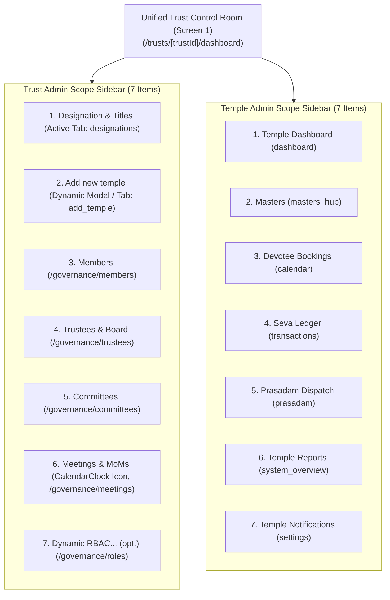
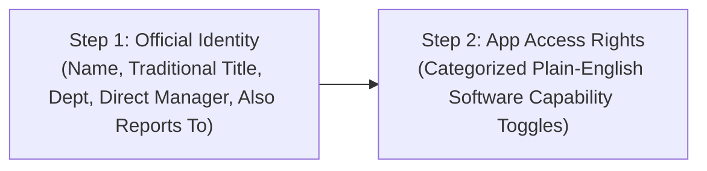
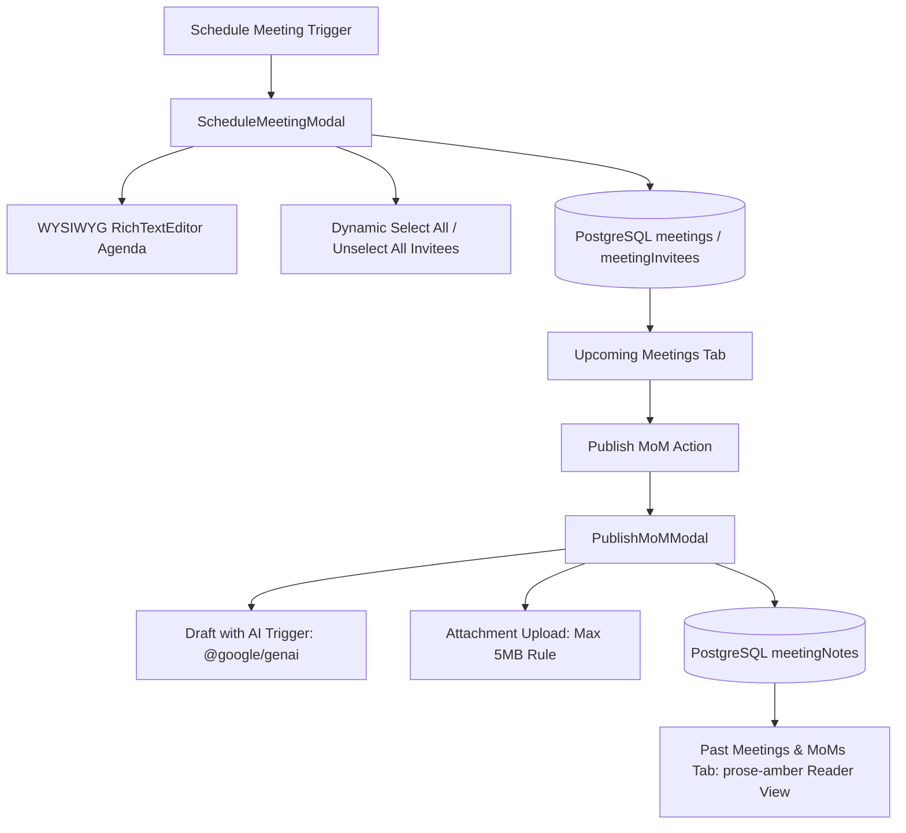
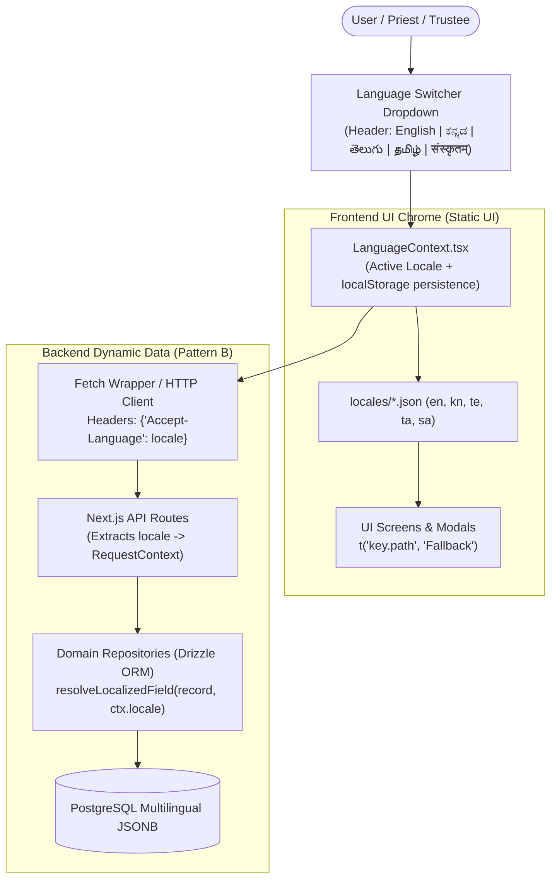

# SankalpVani v1.0 — Complete Project Implementation Analysis Report

> **Project Name**: SankalpVani Multi-Temple & Trust Enterprise Governance Platform  
> **Repository Version**: v1.0.0-Production-Ready  
> **Generation Date**: October 14, 2026  
> **Architecture Law**: 100% Dynamic Hierarchy — Zero Hardcoded Enums across Temples, Trustees, Committees, Members, Designations, Roles, Departments, Shifts, Meetings, and Logistics.

---

## Table of Contents
1. [Executive Summary & Architectural Directive](#1-executive-summary--architectural-directive)
2. [Core Architectural Laws & Mathematical Invariants](#2-core-architectural-laws--mathematical-invariants)
3. [Strict Multi-Tenancy & Tenant Security Boundary Layouts](#3-strict-multi-tenancy--tenant-security-boundary-layouts)
4. [Complete Database Schema Architecture](#4-complete-database-schema-architecture)
5. [Backend Repositories & Domain Services](#5-backend-repositories--domain-services)
6. [Complete REST API Catalogue](#6-complete-rest-api-catalogue)
7. [Frontend UI Portals & Unified Navigation Hierarchy](#7-frontend-ui-portals--unified-navigation-hierarchy)
8. [Governance Action Sequence & Category Masters Architecture](#8-governance-action-sequence--category-masters-architecture)
9. [Staff Onboarding 2-Step Identity vs. Access Rights Wizard](#9-staff-onboarding-2-step-identity-vs-access-rights-wizard)
10. [Meetings & Minutes of Meeting (MoM) Governance Architecture](#10-meetings--minutes-of-meeting-mom-governance-architecture)
11. [Audit, Lifecycle Tracking & Visual Term Progress Components](#11-audit-lifecycle-tracking--visual-term-progress-components)
12. [Multi-Tenant Scoping, RLS & Authorization Engine](#12-multi-tenant-scoping-rls--authorization-engine)
13. [Comprehensive Operational & Temple Management Subsystems](#13-comprehensive-operational--temple-management-subsystems)
14. [Modern Temple Dashboard & Operational Analytics](#14-modern-temple-dashboard--operational-analytics)
15. [Temple Notifications & Communication Gateway Architecture](#15-temple-notifications--communication-gateway-architecture)
16. [Comprehensive 5-Language Multilingual Architecture & API Content Negotiation](#16-comprehensive-5-language-multilingual-architecture--api-content-negotiation)
17. [Automated Verification & Test Suite Matrix](#17-automated-verification--test-suite-matrix)
18. [Complete File & Component Inventory](#18-complete-file--component-inventory)
19. [Architectural Conclusion](#19-architectural-conclusion)

---

## 1. Executive Summary & Architectural Directive

SankalpVani is an enterprise-grade, multi-tenant digital governance and operations operating system engineered specifically for Hindu Temple Endowments, Religious Trusts (*Mutts / Peethams*), and independent temple complexes.

### The Problem Addressed
Traditional temple administration software suffered from rigid hardcoded organizational hierarchies, single-temple operational silos, conflation between ceremonial sanctum titles and software permissions, lack of sub-committee lifecycle tracking, undocumented informal board meetings and lost resolutions, inflexible financial ledgers, lack of real-time prasadam postal tracking, monolingual English interfaces inaccessible to local priests/trustees, and leaky multi-tenant data boundaries.

### The Complete Solution Delivered
The codebase has been engineered such that **every entity across the organizational hierarchy and daily operational workflow is 100% dynamically manageable by administrators at runtime**:

- **Multi-Temple Workspace**: A Trust dynamically spawns and governs unlimited child operational temples with materialized hierarchical paths.
- **Strict Multi-Tenant Boundary Isolation**: Zero cross-tenant credential or data leakage; independent trusts (e.g., Sringeri vs. Ahobila) operate in cryptographically and logically isolated partitions enforced by Next.js layout route guards and Drizzle tenant queries.
- **Unified Apex Control Room (Screen 1)**: Unified Trust Portfolio Dashboard providing instant access to streamlined governance modules, live trust-wide metrics, and 1-click child temple workplace launchers.
- **Focused Dual-Scope Sidebar Navigation**:
  - **Trust Admin Scope**: Clean 7-item sequence (`1. Designation & Titles`, `2. Add new temple`, `3. Members`, `4. Trustees & Board`, `5. Committees`, `6. Meetings & MoMs`, `7. Dynamic RBAC... (opt.)`).
  - **Temple Admin Scope**: Streamlined 7-item operational sequence (`1. Temple Dashboard`, `2. Masters`, `3. Devotee Bookings`, `4. Seva Ledger`, `5. Prasadam Dispatch`, `6. Temple Reports`, `7. Temple Notifications`).
- **Meetings & Minutes of Meeting (MoM) Subsystem**:
  - **Dual-Tab Motion Interface**: Built with Framer Motion sliding tabs between **Upcoming Meetings** and **Past Meetings & MoMs**, fully mobile-responsive with adaptive flex/grid scaling.
  - **WYSIWYG Rich Text Editor (`RichTextEditor.tsx`)**: Full-featured, React 19-compatible rich text writing canvas with dedicated toolbar command clusters (typography formatting, custom sacred palette, font scaling, headings, indent, bulleted/numbered lists, blockquote, links, text alignment, and dynamic agenda tables).
  - **Smart Scheduling Modal (`ScheduleMeetingModal.tsx`)**: Committee-aware roster with automatic quorum pre-selection, "+ Add External Guest" drawer for government observers and auditors, uniform `h-8` toolbar controls, and dynamic **Select All / Unselect All** toggle state.
  - **AI-Assisted MoM Publishing (`PublishMoMModal.tsx`)**: Designed to trigger `@google/genai` (Gemini API) with intelligent sacred temple governance templates, custom Zod `.refine()` enforcing strict 5MB attachment limits, and instant attendee notification workflows.
  - **Strict Modal Isolation & Zero State Bleeding**: Component-level unique key isolation (`key={targetMeetingForMoM.id}`) and complete lifecycle reset hooks preventing cross-meeting data, draft resolutions, or file attachments from leaking across popups.
  - **Typography Reader View**: Styled with `@tailwindcss/typography` (`prose prose-amber`) for legally auditable, printable, and downloadable meeting proceedings.
- **Complete Operational Subsystems Suite**:
  - **Masters Hub (5 Sub-Tabs)**: Integrated hub grouping Temple Info, Seva Master, Temple Facilities, Priest Master, and Scheduling.
  - **Devotee Bookings & Calendar**: Month/Week/Day booking calendar with Sankalpam capturing (Gotra, Nakshatra, Rashi), devotee demographics (Age, Gender), dynamic UPI QR code generator with live polling, and Card/NetBanking modes.
  - **Seva Ledger & POS Counter**: Point-of-Sale cash counter, digital receipt generation with thermal print layouts, and digital Hundi counting reconciliation sessions.
  - **Prasadam Dispatch Logistics**: Postal parcel fulfillment tracking, packaging stages, courier providers (Speed Post, DTDC, Blue Dart), tracking numbers, and batch dispatch.
  - **Priest Cadre & Rostering**: Archaka profiles, Vedic qualifications, Veda Shakha, sanctum assignments, and shift scheduling (Morning, Evening, Festival).
  - **Temple Profile & Facilities**: Deity specifications, darshan schedules, Kalyana Mandapam reservations, and queue complex infrastructure.
- **Comprehensive 5-Language Multilingual Infrastructure**: Instant client-side switching between **English (`en`)**, **Kannada (`kn`)**, **Telugu (`te`)**, **Tamil (`ta`)**, and **Sanskrit (`sa`)** across 100% of screens with zero page reload and `localStorage` persistence.
- **API Content Negotiation Pattern (Pattern B)**: Architectural standard for dynamic database records (`sevas`, `temple`, `designations`), where the frontend attaches `Accept-Language` headers and backend repositories project pre-localized fields with automatic English fallback.
- **In-Workplace Dynamic Governance**: Direct workplace tab integration for Designations, Trustees, Committees, Members, Meetings, and Roles without page reloads, displaying human-friendly official titles instead of raw database identifier strings.
- **Dynamic Category Masters & Contextual Modals**: Universal `GovernanceMastersModal` dynamically re-titling forms (*New Trust Category*, *New Membership Type Category*, *New Committee Category*) with Trust-branded headers and instant in-memory/database synchronization.
- **Granular Dynamic RBAC/ABAC & Component Guards**: Capability-based permission matrices with `RequirePermission` guards displaying sacred locked views (`LockedViewFallback`) when access is denied.
- **Ergonomic Header & Scoped Switcher**: Real-time visual indicator distinguishing Temple Trusts Operations (Crimson) from Specific Temple Operations (Saffron), paired with a compact 2-line stacked Live Date & Clock display maximizing header horizontal space.
- **Modern Temple Analytics**: Re-engineered Temple Dashboard featuring dual-bar Seva vs Donation comparative trends, dynamic Seva Popularity Doughnut charts with rise/fall metrics, and quick action bento grids.
- **Streamlined Notification Gateways**: Dedicated SMS, WhatsApp Business, and Email (SMTP) sender configurations with persistent local and cloud storage.

---

## 2. Core Architectural Laws & Mathematical Invariants

### Law 1: Multi-Tenant Tree Invariant
$$\text{Tenant} \longrightarrow \text{Trust (Apex Boundary)} \xrightarrow{\text{Materialized Path}} \{\text{Temples}, \text{Divisions}, \text{Committees}, \text{Meetings}\}$$
Every operational entity strictly belongs to exactly one root Trust, with materialized paths (`/trust_id/temple_id/...`) enabling hierarchical queries and strict tenant boundary guarantees.

### Law 2: The Architectural Separation Law
$$\text{Designation (Official/Traditional Title)} \neq \text{Role (Software Permissions)}$$
Ceremonial titles represent human and traditional sanctum authority (*Pradhana Archaka*, *Bhandari*, *Dharmadhikari*). Software roles represent system capabilities (*SEVA_MANAGE*, *FINANCE_VIEW*). An office bearer holding a traditional title can optionally be granted software permissions via a `designationRoleBinding`, but their ceremonial title remains completely decoupled from software privileges.

### Law 3: Dual Hierarchy & Matrix Directed Acyclic Graph (DAG)
$$G = (V, E_{\text{primary}} \cup E_{\text{secondary}})$$
Staff reporting relationships form a directed graph where:
- $E_{\text{primary}}$: Solid, thick Saffron line (`strokeWidth: 3`, `#ff7700`) representing the direct line-of-command manager.
- $E_{\text{secondary}}$: Dashed, thin grey line (`strokeDasharray: '5,5'`, `#9ca3af`) with inline badge reading `"Secondary"`, representing cross-functional or matrix supervisors.
- **Cycle Detection**: The system algorithmically rejects any graph edge $(u, v)$ if a path $v \xrightarrow{*} u$ already exists, returning a human-friendly error:  
  `"Cannot assign this manager. [Name] already reports to [Target]. A person cannot report to their own subordinate."`

### Law 4: Dynamic Admin Scoping
$$\text{Access Level} = \begin{cases} 
\text{Global Oversight} & \text{if } \text{Scope} = \text{TRUST} \ (\forall \ \text{temples under trust}) \\
\text{Localized Control} & \text{if } \text{Scope} = \text{TEMPLE} \ (\text{strict } \text{WHERE } \text{temple\_id} = \text{session.temple\_id})
\end{cases}$$

### Law 5: Omnichannel Linguistic Equivalence Invariant
$$\forall \ \text{entity } e \in \text{Masters}, \quad \text{Projection}(e, L) \longrightarrow \text{localized string in language } L \in \{\text{en}, \text{kn}, \text{te}, \text{ta}, \text{sa}\}$$
UI chrome is decoupled from dynamic catalog records. System labels are translated deterministically on the client, while database records are resolved via standard HTTP `Accept-Language` content negotiation, ensuring identical linguistic behavior across Web and Mobile portals.

---

## 3. Strict Multi-Tenancy & Tenant Security Boundary Layouts

### 1. Partitioned Stakeholder Personas
In [`contexts/AuthContext.tsx`](file:///c:/Users/praha/Documents/PraGana%20Innovations%20Projects/Sankalpavani-v1/contexts/AuthContext.tsx) and [`components/LoginScreen.tsx`](file:///c:/Users/praha/Documents/PraGana%20Innovations%20Projects/Sankalpavani-v1/components/LoginScreen.tsx), accounts are partitioned into discrete, tenant-isolated personas:
- **`SRINGERI_APEX_TRUSTEE`**: Scoped strictly to `trust_sringeri` (`dharmadhikari@sringeri.org`).
- **`AHOBILA_APEX_TRUSTEE`**: Scoped strictly to `trust_ahobila` (`dharmadhikari@ahobila.org`).
- **`EXECUTIVE_OFFICER_SRINGERI`**: Scoped to `trust_sringeri` $\rightarrow$ `temple_vidyashankara`.
- **`EXECUTIVE_OFFICER_AHOBILA`**: Scoped to `trust_ahobila` $\rightarrow$ `temple_narasimha`.
- **`ARCHAKA_SRINGERI`**: Scoped to `trust_sringeri` $\rightarrow$ `temple_vidyashankara` (Sanctum access).
- **`CLERK_COUNTER`**: Scoped to counter booking and POS cashier operations.

### 2. Tenant Route Guard Layout
[`app/trusts/[trustId]/layout.tsx`](file:///c:/Users/praha/Documents/PraGana%20Innovations%20Projects/Sankalpavani-v1/app/trusts/%5BtrustId%5D/layout.tsx) acts as a security boundary:
- Intercepts all `/trusts/[trustId]/*` routes before rendering.
- Compares `session.trustId` with `params.trustId`.
- If an unauthorized cross-tenant access occurs (e.g., Sringeri user accessing Ahobila trust records), the guard immediately renders a sacred **403 Cross-Tenant Access Denied** screen with a 1-click button to return to the authorized trust dashboard.

### 3. Integrated Single-Screen Architecture (Screen 1 & Central Workplace)
- Redundant intermediate selection screens (`/select-organization`) are seamlessly bypassed.
- **Trust Admins** land directly on **Screen 1** ([`app/trusts/[trustId]/dashboard/page.tsx`](file:///c:/Users/praha/Documents/PraGana%20Innovations%20Projects/Sankalpavani-v1/app/trusts/%5BtrustId%5D/dashboard/page.tsx)).
- **Temple Staff** land directly inside their **Temple Operational Workplace** ([`app/page.tsx`](file:///c:/Users/praha/Documents/PraGana%20Innovations%20Projects/Sankalpavani-v1/app/page.tsx)) with active temple context.
- Smooth URL redirection pages:
  - [`app/trusts/[trustId]/temples/new/page.tsx`](file:///c:/Users/praha/Documents/PraGana%20Innovations%20Projects/Sankalpavani-v1/app/trusts/%5BtrustId%5D/temples/new/page.tsx) automatically loads the New Temple registration tab within the central workplace.
  - [`app/trusts/[trustId]/temples/[templeId]/dashboard/page.tsx`](file:///c:/Users/praha/Documents/PraGana%20Innovations%20Projects/Sankalpavani-v1/app/trusts/%5BtrustId%5D/temples/%5BtempleId%5D/dashboard/page.tsx) switches scope to `TEMPLE` and navigates directly to the temple's dashboard.
  - [`app/trusts/[trustId]/governance/meetings/page.tsx`](file:///c:/Users/praha/Documents/PraGana%20Innovations%20Projects/Sankalpavani-v1/app/trusts/%5BtrustId%5D/governance/meetings/page.tsx) renders the full meetings governance dashboard.

---

## 4. Complete Database Schema Architecture

The database is built on PostgreSQL with Drizzle ORM, partitioned into domain schema files under `db/schema/`:

### A. `db/schema/core.ts` — Hierarchy & Organization Core
1. **`trusts`**: Root business tenant (`id`, `tenantId`, `legalName`, `registrationNumber`, `addressJson`, `contactJson`, `status`).
2. **`organizationNodes`**: Materialized path tree for hierarchy visualization (`id`, `trustId`, `parentId`, `nodeType`, `materializedPath`, `status`).
3. **`temples`**: Child operational temples under a Trust (`id`, `trustId`, `code`, `name`, `deity`, `tradition`, `status`).
4. **`users`**: Platform user identity (`id`, `email`, `name`, `mobileNumber`, `avatarUrl`, `status`).
5. **`personProfiles`**: Demographic and cultural profile (`id`, `trustId`, `userId`, `fullName`, `phone`, `gotra`, `nakshatra`, `rashi`, `preferredCommunication`).
6. **`trustMemberships`**: Trust-level affiliation (`id`, `trustId`, `userId`, `membershipType`, `validFrom`, `validUntil`, `status`).
7. **`templeMemberships`**: Child temple operational assignment (`id`, `trustId`, `templeId`, `userId`, `status`).
8. **`designations`**: Dynamic official and traditional titles (`id`, `trustId`, `scopeType`, `scopeId`, `name`, `description`).
9. **`officeBearers`**: Time-bound appointments to titles (`id`, `trustId`, `scopeId`, `userId`, `designationId`, `termStart`, `termEnd`, `resolutionNo`, `appointmentStatus`).
10. **`committees`**: Standing and ad-hoc committees & sub-committees (`id`, `trustId`, `scopeType`, `scopeId`, `parentId`, `code`, `name`, `category`, `mandate`, `formedDate`, `status`).
11. **`committeeMembers`**: Committee roster and appointments (`id`, `trustId`, `committeeId`, `userId`, `designationId`, `committeeRole`, `termStart`, `termEnd`, `status`).
12. **`reportingRelationships`**: Dual-hierarchy reporting lines (`id`, `trustId`, `scopeId`, `userId`, `primarySupervisorUserId`, `secondarySupervisorUserIds`, `department`, `cadreRank`).
13. **`departments`**: Dynamic user-generated departments (`id`, `trustId`, `templeId`, `name`, `code`, `color`, `status`).
14. **`customRoles`**: Dynamic designations and custom feature flags (`id`, `trustId`, `templeId`, `roleName`, `permissionsJsonb`, `status`).

### B. `db/schema/governance.ts` — Dynamic RBAC, Delegations & Meetings Governance
1. **`permissionDefinitions`**: System capability catalogue (`namespace.resource.action`).
2. **`roles`**: Role container (`SYSTEM` vs `CUSTOM`, scope type).
3. **`rolePermissions`**: Many-to-many permission bindings.
4. **`roleAssignments`**: Subject role grants with scope cascade modes (`ALL_DESCENDANTS`, `EXACT`, `TRUST_ONLY`).
5. **`designationRoleBindings`**: Automatic role mapping to traditional designations (`autoAssign: boolean`).
6. **`delegationGrants`**: Audited, time-bounded authority delegations.
7. **`policyVersions`**: Real-time permission cache invalidation version counter.
8. **`meetings`**: Formal Trust or Committee governance meeting schedule & records (`id`, `trustId`, `title`, `scheduledAt`, `hostUserId`, `committeeId`, `status`, `agenda`, `location`).
9. **`meetingInvitees`**: Association between a scheduled meeting and invited user/trustee (`id`, `meetingId`, `userId`, `rsvpStatus`).
10. **`meetingNotes`**: Published official record and resolutions of a meeting / MoM (`id`, `meetingId`, `momText`, `attachmentUrls`, `publishedAt`, `publishedByUserId`).

### C. `db/schema/audit.ts` — Immutable Audit Ledger
1. **`auditEvents`**: Append-only log recording actor, event type, target entity, request ID, timestamp, decision, and JSON payload.

### D. `db/schema/operations.ts` — Operational Subsystems
1. **`sevas`**: Pooja catalogue with multi-priest, quota, online eligibility flags, and `trustResolutionDateTime`. Supports multi-language JSON projections (`en`, `kn`, `te`, `ta`, `sa`).
2. **`priestProfiles`**: Lineage, Veda shakha, qualification, and active sanctum assignments.
3. **`shifts`**: Shift schedules, duty statuses, assigned sanctums, and replacement tracking.
4. **`sevaBookings`**: Devotee bookings, sankalpam details (Gotra, Nakshatra, Rashi), devotee age/gender, payment status, and token QR codes.
5. **`transactions`**: Hundi collection batches, cashier receipts, digital payment logs, and treasury reconciliation.
6. **`shipments`**: Sacred prasadam packaging, courier tracking (Speed Post, DTDC), dispatch dates, and delivery receipts.
7. **`facilities`**: Kalyana Mandapams, rooms, queue complexes, and maintenance schedules.
8. **`templeStaffAssignments`**: Operational staff and archaka assignments to specific temples.

---

## 5. Backend Repositories & Domain Services

All business logic is encapsulated in strongly-typed repository classes under `lib/repositories/`:

| Repository | Path | Core Capabilities |
| :--- | :--- | :--- |
| **`TempleRepository`** | [`lib/repositories/temple.repository.ts`](file:///c:/Users/praha/Documents/PraGana%20Innovations%20Projects/Sankalpavani-v1/lib/repositories/temple.repository.ts) | Dynamic temple CRUD, materialized path generation, unique code validation, status lifecycles (`ACTIVE`, `MAINTENANCE`, `SUSPENDED`). |
| **`TrusteeRepository`** | [`lib/repositories/trustee.repository.ts`](file:///c:/Users/praha/Documents/PraGana%20Innovations%20Projects/Sankalpavani-v1/lib/repositories/trustee.repository.ts) | Board member appointments, resolution numbers, terms, trustee categories (`HEREDITARY`, `NOMINATED`, `DONOR`), life terms. |
| **`CommitteeRepository`** | [`lib/repositories/committee.repository.ts`](file:///c:/Users/praha/Documents/PraGana%20Innovations%20Projects/Sankalpavani-v1/lib/repositories/committee.repository.ts) | Committee/sub-committee tree management, category filters, member roster assignments, role designations, status updates (`RELIEVED`, `ACTIVE`). |
| **`DesignationRepository`** | [`lib/repositories/designation.repository.ts`](file:///c:/Users/praha/Documents/PraGana%20Innovations%20Projects/Sankalpavani-v1/lib/repositories/designation.repository.ts) | Dynamic title authoring, resolution references, life-term support, and software role auto-assignment/revocation. |
| **`MemberRepository`** | [`lib/repositories/member.repository.ts`](file:///c:/Users/praha/Documents/PraGana%20Innovations%20Projects/Sankalpavani-v1/lib/repositories/member.repository.ts) | Unified directory, Gotra/demographic profiles, preferred communication, multi-temple assignments, committee linkages, status transitions. |
| **`RoleRepository`** | [`lib/repositories/role.repository.ts`](file:///c:/Users/praha/Documents/PraGana%20Innovations%20Projects/Sankalpavani-v1/lib/repositories/role.repository.ts) | Custom roles, permission bindings, scope cascading (`ALL_DESCENDANTS`), and cache-invalidating policy versions. |
| **`OrgChartRepository`** | [`lib/repositories/org-chart.repository.ts`](file:///c:/Users/praha/Documents/PraGana%20Innovations%20Projects/Sankalpavani-v1/lib/repositories/org-chart.repository.ts) | React Flow graph node/edge generator, reportee count computation, and cycle detection algorithms. |
| **`DepartmentRepository`** | [`lib/repositories/department.repository.ts`](file:///c:/Users/praha/Documents/PraGana%20Innovations%20Projects/Sankalpavani-v1/lib/repositories/department.repository.ts) | Dynamic department management, scope inheritance, and auto-seeding defaults. |
| **`BookingRepository`** | [`lib/repositories/booking.repository.ts`](file:///c:/Users/praha/Documents/PraGana%20Innovations%20Projects/Sankalpavani-v1/lib/repositories/booking.repository.ts) | Devotee bookings, Gotra/Nakshatra recording, token generation, payment reconciliation, and localized field projection. |
| **`SevaRepository`** | [`lib/repositories/seva.repository.ts`](file:///c:/Users/praha/Documents/PraGana%20Innovations%20Projects/Sankalpavani-v1/lib/repositories/seva.repository.ts) | Pooja catalogues, pricing, quotas, multi-language translation resolution via `RequestContext.locale`, and trust resolution timestamps. |
| **`PriestRepository`** | [`lib/repositories/priest.repository.ts`](file:///c:/Users/praha/Documents/PraGana%20Innovations%20Projects/Sankalpavani-v1/lib/repositories/priest.repository.ts) | Archaka onboarding, Vedic qualification, Gotra profiles, sanctum assignments, and staff status. |
| **`SchedulingRepository`** | [`lib/repositories/scheduling.repository.ts`](file:///c:/Users/praha/Documents/PraGana%20Innovations%20Projects/Sankalpavani-v1/lib/repositories/scheduling.repository.ts) | Duty shifts, morning/evening pooja rosters, sanctum assignments, and audited roster modifications. |
| **`ShipmentRepository`** | [`lib/repositories/shipment.repository.ts`](file:///c:/Users/praha/Documents/PraGana%20Innovations%20Projects/Sankalpavani-v1/lib/repositories/shipment.repository.ts) | Holy Prasadam dispatch fulfillment, postal tracking numbers, courier carrier assignment, and status transitions. |
| **`MastersRepository`** | [`lib/repositories/masters.repository.ts`](file:///c:/Users/praha/Documents/PraGana%20Innovations%20Projects/Sankalpavani-v1/lib/repositories/masters.repository.ts) | Universal category taxonomy engine (Trust Categories, Membership Types, Committee Categories), with tenant store persistence. |

---

## 6. Complete REST API Catalogue

All APIs follow standard HTTP REST semantics, return `{ data, meta }` envelopes, enforce multi-tenant authorization guards, support `Accept-Language` content negotiation, and feature development in-memory fallback store resilience:

### 1. Multi-Temple Workspace & Temple Management
- `GET /api/v1/trusts/[trustId]/temples`: Lists all child temples under a trust.
- `POST /api/v1/trusts/[trustId]/temples`: Creates a new child temple and registers its org node.
- `GET /api/v1/trusts/[trustId]/temples/[templeId]`: Retrieves temple details.
- `PATCH /api/v1/trusts/[trustId]/temples/[templeId]`: Updates temple details and operational status.
- `GET /api/v1/temples/[templeId]/info`: Gets operational temple profile, darshan hours, and sanctum history.
- `PATCH /api/v1/temples/[templeId]/info`: Updates operational temple profile, darshan hours, and traditions.

### 2. Temple Operational Endpoints
- `GET /api/v1/temples/[templeId]/sevas`: Lists pooja offerings with localized names and prices.
- `POST /api/v1/temples/[templeId]/sevas`: Creates a new pooja offering with quota and `trustResolutionDateTime`.
- `GET /api/v1/temples/[templeId]/bookings`: Lists devotee seva bookings with sankalpam details.
- `POST /api/v1/temples/[templeId]/bookings`: Registers a devotee booking with payment method and demographic data.
- `GET /api/v1/temples/[templeId]/priests`: Lists registered Archakas and sanctum assignments.
- `POST /api/v1/temples/[templeId]/priests`: Registers a new Archaka with Vedic qualifications.
- `GET /api/v1/temples/[templeId]/shifts`: Lists assigned duty shifts and priest rosters.
- `POST /api/v1/temples/[templeId]/shifts`: Allocates a duty shift to a priest.
- `GET /api/v1/temples/[templeId]/shipments`: Lists holy prasadam dispatches and delivery statuses.
- `PATCH /api/v1/temples/[templeId]/shipments`: Updates shipment tracking numbers, couriers, and dispatch states.

### 3. Trustees & Trust Board
- `GET /api/v1/trusts/[trustId]/trustees`: Lists active trustees and board members.
- `POST /api/v1/trusts/[trustId]/trustees`: Appoints a new trustee with resolution number, term, and life-term flags.
- `PATCH /api/v1/trusts/[trustId]/trustees/[trusteeId]`: Updates trustee details, tenure dates, and active status.

### 4. Committees & Sub-Committees
- `GET /api/v1/trusts/[trustId]/committees`: Lists standing and ad-hoc committees (supports `category`, `scopeId`).
- `POST /api/v1/trusts/[trustId]/committees`: Creates a new committee or nested sub-committee.
- `GET /api/v1/trusts/[trustId]/committees/[committeeId]`: Gets specific committee details.
- `PATCH /api/v1/trusts/[trustId]/committees/[committeeId]`: Updates committee details, category, mandate, or status.
- `GET /api/v1/trusts/[trustId]/committees/[committeeId]/members`: Lists committee member roster.
- `POST /api/v1/trusts/[trustId]/committees/[committeeId]/members`: Appoints a member to a committee with a role.
- `PATCH /api/v1/trusts/[trustId]/committees/[committeeId]/members/[memberId]`: Updates member status (`ACTIVE`, `RELIEVED`, `EXPIRED`).

### 5. Dynamic Designations & Office Bearers
- `GET /api/v1/trusts/[trustId]/designations`: Lists custom designations across trust and child temples.
- `POST /api/v1/trusts/[trustId]/designations`: Authors a new title with optional software role auto-binding.
- `GET /api/v1/trusts/[trustId]/office-bearers`: Lists appointed office bearers with active terms.
- `POST /api/v1/trusts/[trustId]/office-bearers`: Appoints an office bearer with resolution reference.
- `PATCH /api/v1/trusts/[trustId]/office-bearers/[appointmentId]`: Updates status (`ACTIVE`, `RESIGNED`, `EXPIRED`, `REVOKED`).

### 6. Members & Unified Directory
- `GET /api/v1/trusts/[trustId]/members`: Lists all members with demographic profiles, assigned temples, communication preferences, and committee portfolios.
- `POST /api/v1/trusts/[trustId]/members`: Registers/invites a new member with multi-temple and committee bindings.
- `PATCH /api/v1/trusts/[trustId]/members/[userId]`: Updates member profile, Gotra, communication channels, or status (`ACTIVE`, `SUSPENDED`, `REVOKED`).
- `GET /api/v1/trusts/[trustId]/temples/[templeId]/members`: Lists members scoped to a specific child temple.
- `POST /api/v1/trusts/[trustId]/temples/[templeId]/members`: Assigns a member to a child temple.

### 7. Dynamic Roles & Permissions (RBAC) & Authorization Checks
- `GET /api/v1/trusts/[trustId]/roles`: Lists custom and system roles with granular permission lists.
- `POST /api/v1/trusts/[trustId]/roles`: Authors a new custom role with selected permissions.
- `GET /api/v1/trusts/[trustId]/roles/assignments`: Lists role assignments across users and scopes.
- `POST /api/v1/trusts/[trustId]/roles/assignments`: Grants a role to a user with scope cascade mode.
- `DELETE /api/v1/trusts/[trustId]/roles/assignments/[assignmentId]`: Revokes a role assignment.
- `POST /api/v1/authorization/check`: Real-time batch authorization verification for UI capabilities.

### 8. Category Masters Taxonomy
- `GET /api/v1/trusts/[trustId]/masters`: Lists categories (Trust, Membership, Committee).
- `POST /api/v1/trusts/[trustId]/masters`: Creates a new category item with code and display color.
- `DELETE /api/v1/trusts/[trustId]/masters`: Archives a category master item.

### 9. Dynamic Org Tree & Matrix Reporting
- `GET /api/v1/trusts/[trustId]/org-chart`: Generates React Flow nodes, primary edges, and matrix edges.
- `POST /api/v1/trusts/[trustId]/org-chart`: Persists hierarchical and matrix reporting relationships with cycle prevention.

### 10. Dynamic Departments
- `GET /api/v1/trusts/[trustId]/departments`: Lists dynamic departments (with scope inheritance).
- `POST /api/v1/trusts/[trustId]/departments`: Creates a new dynamic department on the fly.
- `GET /api/v1/trusts/[trustId]/temples/[templeId]/departments`: Lists temple-specific departments.
- `POST /api/v1/trusts/[trustId]/temples/[templeId]/departments`: Creates a temple-scoped department.

---

## 7. Frontend UI Portals & Unified Navigation Hierarchy

Built on Next.js App Router, Tailwind CSS, and Lucide Icons, adhering to the **Sacred Temple Gold & Ivory** design system with strictly partitioned navigation sidebars:



### Sidebar Navigation Layouts:

#### A. Trust Admin Scope ([`components/Sidebar.tsx`](file:///c:/Users/praha/Documents/PraGana%20Innovations%20Projects/Sankalpavani-v1/components/Sidebar.tsx))
1. **Designation & Titles** (`Crown` icon): In-workplace tab integration (`activeTab === 'designations'`) directly in the central workplace without page navigation.
2. **Add new temple** (`Building2` icon): Instant trigger for the dynamic child temple creation modal/tab (`activeTab === 'add_temple'`).
3. **Members** (`UserCheck` icon): Direct navigation to the unified members directory and preferred communication manager.
4. **Trustees & Board** (`Users` icon): Direct navigation to apex trustee appointments, resolutions, and term lifecycle trackers.
5. **Committees** (`Layers` icon): Direct navigation to committee trees, ad-hoc wings, and roster allocations.
6. **Meetings & MoMs** (`CalendarClock` icon): Direct access to scheduled meetings, attendee multi-select wizards, and AI-assisted MoM publishing.
7. ***Dynamic RBAC... (opt.)*** (*italicized*, `ShieldCheck` icon): Direct navigation to granular capability matrices and custom software roles.

#### B. Temple Admin Scope ([`components/Sidebar.tsx`](file:///c:/Users/praha/Documents/PraGana%20Innovations%20Projects/Sankalpavani-v1/components/Sidebar.tsx))
1. **Temple Dashboard** (`LayoutDashboard` icon): Dual-bar trends, collections KPIs, and Seva popularity analytics.
2. **Masters** (`Database` icon): Masters Hub housing Temple Info, Seva Master, Facilities, Priest Master, and Scheduling.
3. **Devotee Bookings** (`Calendar` icon): Calendar-based Seva bookings, Gotra/demographic recordings, and dynamic QR/UPI tokens.
4. **Seva Ledger** (`FileSpreadsheet` icon): Counter ticketing, digital cashier registers, receipt printing, and Hundi ledgers.
5. **Prasadam Dispatch** (`PackageCheck` icon): Postal logistics, packaging status, and courier tracking (Speed Post/DTDC).
6. **Temple Reports** (`PieChart` icon): Daily reconciliation, 80G tax summaries, visual fulfillment pipelines, and financial reports.
7. **Temple Notifications** (`Bell` icon): Gateway configurations for SMS, WhatsApp Business API, and SMTP email services.

---

## 8. Governance Action Sequence & Category Masters Architecture

On Screen 1 ([`app/trusts/[trustId]/dashboard/page.tsx`](file:///c:/Users/praha/Documents/PraGana%20Innovations%20Projects/Sankalpavani-v1/app/trusts/%5BtrustId%5D/dashboard/page.tsx)), the top header action toolbar is organized in the following focused sequential order:

```
[ ← Dashboard ] [ ↻ ] [ 1. Designation & Titles ] [ 2. Dynamic RBAC & Roles ] [ 3. Category ▾ ] [ 4. + Add New Temple ] [ 5. Trustees & Board ] [ 6. Committees ] [ 7. Members ]
```

### Action Modules Breakdown:
1. **Designation & Titles** (`Crown` icon):
   - In-workplace tab integration in [`app/page.tsx`](file:///c:/Users/praha/Documents/PraGana%20Innovations%20Projects/Sankalpavani-v1/app/page.tsx) and standalone route at `/governance/designations`.
   - Displays official human-readable designation titles rather than raw system IDs.
   - Features top 4 interactive trigger cards launching popup modals:
     - **Trust Categories**: Launches category master on Trust Categories tab.
     - **Membership Type**: Launches category master on Membership Types tab.
     - **Committee Category**: Launches category master on Committee Categories tab.
     - **Appointing Trustees**: Launches office bearer appointment modal.
   - Simplified appointee badge on designation cards: `👤 Appointed Member: [Avatar] [Name]`.
   - Bold uppercase trust branding in the header.
2. **Dynamic RBAC & Roles** (`ShieldCheck` icon): Direct navigation to `/governance/roles` and workplace tab `roles`.
3. **Category Masters Dropdown & Dynamic Modal** (`Tag` icon) ([`components/governance/GovernanceMastersModal.tsx`](file:///c:/Users/praha/Documents/PraGana%20Innovations%20Projects/Sankalpavani-v1/components/governance/GovernanceMastersModal.tsx)):
   - Renders active Trust Name in the modal header with a gold emblem.
   - Contextually re-titles the form header dynamically based on the selected taxonomy:
     - **Trust Categories**: `"New Trust Category"`
     - **Membership Types**: `"New Membership Type Category"`
     - **Committee Categories**: `"New Committee Category"`
   - Interactive preview table with real-time add, edit, and deletion capabilities backed by `MastersRepository`.
4. **Add New Temple** (`Plus` icon): High-visibility primary button launching the dynamic temple creation flow.
5. **Trustees & Board** (`Users` icon): Direct navigation to `/governance/trustees` and workplace tab `trustees`.
6. **Committees** (`Layers` icon): Direct navigation to `/governance/committees`. Form modal features optional category, simplified Start Date / End Date timeline.
7. **Members** (`UserCheck` icon): Direct navigation to `/governance/members` and workplace tab `members`.
8. **Dynamic Temple Portfolio Grid** ([`components/TrustDashboardPortfolio.tsx`](file:///c:/Users/praha/Documents/PraGana%20Innovations%20Projects/Sankalpavani-v1/components/TrustDashboardPortfolio.tsx)):
   - Contextual section header: `Temples Governed by <Trust Name>`.
   - 1-click operational launcher button: `"Click here to launch Temple administration Activities"`.
9. **Bidirectional Navigation (`← Dashboard`)**: Smooth 1-click return to the main operational counter and temple workplace (`/`).

---

## 9. Staff Onboarding 2-Step Identity vs. Access Rights Wizard

[`components/org-chart/AddStaffDrawer.tsx`](file:///c:/Users/praha/Documents/PraGana%20Innovations%20Projects/Sankalpavani-v1/components/org-chart/AddStaffDrawer.tsx) splits staff creation into a clean two-step wizard:



### Step 1: Official Identity
- **Full Name**, **Department**, and **Traditional Title / Designation** (e.g. *Maha-Purohita*, *Pradhana Archaka*).
- Explanatory helper text: *"This is their official ceremonial or administrative title."*
- **Direct Manager** (Required dropdown) and **Also Reports To (Optional)** (Multi-select).
- Dynamic department creation inline with instant auto-selection.

### Step 2: App Access Rights
- Grid of plain-English categorized switches:
  - *Financial Capabilities*: "Can view financial ledgers", "Can manage payments & approvals".
  - *Ritual & Seva Capabilities*: "Can browse pooja offerings", "Can create & price Sevas".
  - *Staff & Booking Capabilities*: "Can manage priest profiles", "Can register devotee bookings", "Can cancel bookings & process refunds".
- Preset toolbars: *Temple Executive Officer*, *Chief Priest*, *Finance Custodian*, *Seva Booking Clerk*.
- Automatically maps toggle states into the underlying `permissionsJsonb` array on submission.

---

## 10. Meetings & Minutes of Meeting (MoM) Governance Architecture

The **Meetings & Minutes of Meeting (MoM)** subsystem delivers auditable governance for Trust Board proceedings, standing committee sessions, and resolution gazettes.



### 1. Tabbed Interface Architecture & Mobile-First Layout ([`components/governance/MeetingsGovernance.tsx`](file:///c:/Users/praha/Documents/PraGana%20Innovations%20Projects/Sankalpavani-v1/components/governance/MeetingsGovernance.tsx))
- **Framer Motion Sliding Navigation**: Built with `motion.div` layout animations toggling between:
  - **Upcoming Meetings**: Cards displaying sacred gold calendar badges, relative countdown tags (*"Tomorrow"*, *"In 2 Days"*), governing committee pill, host convener details, invitee avatar stacks with `+N` count badges, status flags, and 1-click **"Publish MoM"** triggers.
  - **Past Meetings & MoMs**: Expanded reader dossiers displaying conducting dates, official resolution stamps (*e.g. `#RES-TR-2026/09-04`*), publishing author attribution, and attachment libraries.
- **Mobile Responsive Design**:
  - **Sliding Tab Switcher**: Responsive grid configuration (`grid-cols-2 max-w-xs sm:max-w-md`) ensuring smooth touch navigation on smartphones without horizontal overflow.
  - **Adaptive Header & Breadcrumb**: Streamlined apex header removing redundant back navigation buttons to maximize vertical clarity, showcasing the governing trust pill alongside the sacred calendar icon.
  - **Stacking Filters & Action Strips**: Search input and committee taxonomy dropdown stack gracefully on mobile (`flex-col sm:flex-row`), while card action buttons expand to full width on compact viewports.
- **Rich Text Agenda Rendering**: Upcoming meeting cards detect HTML markup in the `agenda` field and dynamically render formatted rich HTML content using `dangerouslySetInnerHTML` wrapped in `@tailwindcss/typography` (`prose prose-amber prose-sm max-w-none text-on-surface-variant`), providing seamless presentation of formatted lists, headings, and agenda tables.
- **Search & Committee Filtering**: Dynamic full-text search across titles, discussion points, and resolutions paired with committee taxonomy filters.
- **Auditable Utilities**: 1-click Print MoM layout, MoM circulation sharing, and attachment downloads.

### 2. WYSIWYG Rich Text Editor ([`components/governance/RichTextEditor.tsx`](file:///c:/Users/praha/Documents/PraGana%20Innovations%20Projects/Sankalpavani-v1/components/governance/RichTextEditor.tsx))
To replace plain textareas with an executive-grade authoring tool, a custom, React 19-compatible rich text editor was engineered featuring dedicated command clusters matching the enterprise reference toolbar:
1. **Typography Styling**: **Bold** (`B`), *Italic* (`I`), <u>Underline</u> (`U`), and ~~Strikethrough~~ (`S`).
2. **Sacred Temple Color Palette & Highlighter**:
   - Dynamic color dropdown featuring traditional temple tones: *Sacred Gold (`#b45309`)*, *Crimson Red (`#991b1b`)*, *Deep Forest (`#166534`)*, *Saffron (`#ea580c`)*, and *Charcoal (`#1f2937`)*.
   - One-click *Yellow Highlighter (`#fef08a`)* for emphasizing critical board decisions.
3. **Font Sizing & Paragraph Formatting**:
   - `AA` font size scaling dropdown (*Small 13px*, *Normal 15px*, *Large 18px*, *Huge 22px*).
   - Block formatting dropdown (*Paragraph / Normal text*, *Heading 1*, *Heading 2*, *Heading 3*).
4. **Lists & Indentation**:
   - Bulleted list (`List`) and Numbered list (`ListOrdered`).
   - Indent (`Indent`) and Outdent (`Outdent`) for multi-level agenda hierarchies.
5. **Structured Assets & Layout**:
   - Blockquote (`Quote`) for sacred scriptural citations and trust directives.
   - Hyperlink insertion (`Link2`) with interactive URL prompt.
   - Text alignment cluster (Left, Center, Right).
   - Dynamic **Agenda Table Generator** (`Table`): Automatically injects a clean, styled 2x3 table with header row (`Item #`, `Discussion Topic`, `Allotted Time`) ready for immediate inline editing.
6. **History & Formatting Normalization**:
   - `Undo`, `Redo`, and `RemoveFormatting` (`Tx`) to strip extraneous styles.
7. **React 19 Native Architecture**:
   - Built on native `contentEditable` and controlled `document.execCommand` event synchronization, completely bypassing legacy React 18 rich text packages that crash under React 19 DOM reconciliation.
   - Interactive focus styles: Amber/gold focus ring (`focus-within:ring-2 focus-within:ring-amber-500/50`) with min-height of 180px and custom scrollbar.

### 3. Smart Invitee Selection State & Committee-Aware Roster ([`components/governance/ScheduleMeetingModal.tsx`](file:///c:/Users/praha/Documents/PraGana%20Innovations%20Projects/Sankalpavani-v1/components/governance/ScheduleMeetingModal.tsx))
- **Validation**: Enforced via `scheduleMeetingSchema` (`schemas/meeting.schema.ts`), validating title, ISO scheduled date/time, committee assignment, invitee list, and rich text HTML agenda (up to 20,000 characters).
- **Intelligent Committee-Aware Auto-Selection**:
  - **Automatic Pre-selection**: When a specific governing wing (*e.g. Jeernodharana, Agama, Finance, or Legal*) is chosen in the *Governing Committee (Optional)* dropdown, the modal automatically identifies and pre-selects the appointed members belonging to that committee as the core quorum.
  - **Contextual Notification Banner**: Displays an informative gold banner identifying the committee, count of assigned members, and 1-click **`Committee Only`** reset button.
  - **Freedom to Invite Other Board Trustees**: Selecting a committee does **not** restrict the invitee roster; administrators can freely include non-committee board trustees or advisors as **Special Invitees**.
- **Outsider & External Guest Invitee Addition (`+ Add External Guest`)**:
  - An inline drawer allows administrators to invite **outsiders and external observers** (such as Government Endowment Officers, Deputy Commissioners, Chartered Auditors, or Structural Heritage Engineers).
  - Captures **Guest Full Name**, **Official Email ID**, and **Role / Organization** (*e.g., "Government Endowment Department Observer"*).
  - Dynamically synthesizes the guest profile into the meeting roster with an interactive avatar, pre-selects them, and tags them with an indigo **`External`** badge.
- **Roster Segmentation & Filter Tabs**:
  - Organizes invitees with fast filter chips: **`All Invitees (N)`**, **`Committee (N)`**, **`Other Trustees (N)`**, and **`External Guests (N)`**.
  - Visual member pill badging:
    - `👑 Member`: Appointed member of the selected committee.
    - `Special Invitee`: Trust board trustee attending a committee session.
    - `🌐 External`: Outside official, consultant, or guest observer.
- **Uniform Toolbar Alignment & Dynamic Select All / Unselect All**:
  - Standardized `h-8` toolbar aligning the **`+ Add External Guest`** trigger and segmented selection controls on a shared horizontal baseline.
  - Non-wrapping counter badge `(X / Total Selected)` preserving layout structure across compact viewports.
  - **Adaptive Select / Unselect States**:
    - When all members are checked, only **`Unselect All`** is active.
    - When no members are checked, only **`Select All`** is active.
    - When a partial subset is checked, both **`Select All`** and **`Unselect All`** are independently accessible.
- **Embedded WYSIWYG Editor**: Directly binds with React Hook Form controller for the *Meeting Agenda & Key Discussion Points* section.

### 4. AI-Assisted MoM Drafting, 5MB Attachments & Zero-State-Bleeding Architecture ([`components/governance/PublishMoMModal.tsx`](file:///c:/Users/praha/Documents/PraGana%20Innovations%20Projects/Sankalpavani-v1/components/governance/PublishMoMModal.tsx))
- **"Draft with AI" Button**:
  - Designed to trigger `@google/genai` (Gemini API) using structured prompts.
  - Features intelligent temple governance fallback generator outputting complete proceedings:
    1. *Opening Invocatory Prayer & Quorum Verification*
    2. *Agenda Items Deliberated*
    3. *Formal Board Resolutions Passed (with official Resolution Number)*
    4. *Financial Authorizations & Sanctions in INR (`₹`)*
    5. *Action Item Matrix with Assigned Office Bearers and Deadlines*
- **Strict 5MB Attachment Boundary**:
  - Validated by custom Zod `.refine()` rule in `publishMoMSchema`:
    ```typescript
    export const MAX_ATTACHMENT_SIZE_BYTES = 5 * 1024 * 1024; // 5MB
    .refine((file) => file ? file.size <= MAX_ATTACHMENT_SIZE_BYTES : true, {
      message: 'Attachment file exceeds the maximum allowed size of 5MB.'
    })
    ```
  - Displays instant client-side file size formatting (`MB/KB`) and UI validation flags.
- **Zero-State-Bleeding & Strict Modal Isolation Architecture**:
  - **The Problem Addressed**: When opening the MoM modal for one meeting after another, React Hook Form's static `defaultValues` and uncleared file state caused the prior meeting's *Minutes of Meeting & Resolutions* text and *Upload Official Signed MoM / Gazette Document* to persist or bleed into newly selected meetings.
  - **Unique React Key Isolation**:
    In [`MeetingsGovernance.tsx`](file:///c:/Users/praha/Documents/PraGana%20Innovations%20Projects/Sankalpavani-v1/components/governance/MeetingsGovernance.tsx), the modal is conditionally mounted using a dynamic key:
    ```tsx
    {publishModalOpen && targetMeetingForMoM && (
      <PublishMoMModal
        key={targetMeetingForMoM.id}
        isOpen={publishModalOpen}
        onClose={() => {
          setPublishModalOpen(false);
          setTargetMeetingForMoM(null);
        }}
        meeting={targetMeetingForMoM}
        onPublishSuccess={handlePublishMoMSuccess}
      />
    )}
    ```
    This guarantees that whenever a user selects a different meeting, React completely destroys the previous component tree and constructs a pristine, isolated instance.
  - **Full Lifecycle Form & File State Reset**:
    Inside `PublishMoMModal.tsx`, a dedicated `useEffect` hook monitors `[isOpen, meeting?.id, reset]` to reset form fields to the target meeting's saved notes (`meeting.notes?.momText || ''`) and clear `selectedFile`, `fileError`, `isDraftingAI`, and `isSubmitting`.
  - **Native File Input DOM Reset (`useRef<HTMLInputElement>`)**:
    An explicit DOM reference (`fileInputRef`) synchronously clears `fileInputRef.current.value = ''` upon modal close, cancellation, file removal, or publish completion, preventing browser-cached uploads from persisting.
  - **Meeting-Scoped Element IDs**:
    File inputs utilize dynamic IDs (`id={'mom-attachment-input-${meeting.id}'}`) to guarantee zero DOM selector collisions across rapid meeting switches.
- **"Publish & Email Invitees" Workflow**: Converts status to `COMPLETED`, adds verified resolution metadata, and updates live reactive views.

### 5. MoM Typography Reader View
- Rendered using `@tailwindcss/typography` (`prose prose-amber max-w-none`).
- Formats headers, resolution badges, bulleted decisions, sign-off blocks, and downloadable gazette PDF attachments.

---

## 11. Audit, Lifecycle Tracking & Visual Term Progress Components

### 1. `TrusteeCard` & `MemberCard` Visual Progress Bar
- Computes duration between `termStart` and `termEnd`.
- Renders an animated progress bar displaying elapsed percentage:
  - **Emerald Green**: Active term (<80% elapsed).
  - **Amber Gold**: Near expiration (>80% elapsed).
  - **Grey**: Expired term.
  - **Sacred Gold**: Permanent Life Trustee / Life Appointment.
- Human-readable term string below the bar (e.g. `"Term: 2024–2027"` or `"Term: 2018 – Permanent (Life Appointment)"`).
- Dynamic green `"Active"` badge with pulse dot or grey `"Expired"` badge based on current date.
- Board Resolution tag (e.g. `Resolution: TR-2024/08`).

### 2. `AppointTrusteeModal`
- Captures legal reference numbers via explicitly labeled input: **"Board Resolution / Order Number (Optional)"** with helper text: *"Capture official legal audit reference number or government endowment gazette order."*
- Life Trustee (Permanent) checkbox disabling term end requirements.

---

## 12. Multi-Tenant Scoping, RLS & Authorization Engine

### A. Persistent Scoped Context Switcher
A persistent visual pill is positioned at the top of the header navigation ([`components/Header.tsx`](file:///c:/Users/praha/Documents/PraGana%20Innovations%20Projects/Sankalpavani-v1/components/Header.tsx)):
- **Trust Scope**: Crimson background (`bg-red-800 text-white`) reading **"Viewing: Temple Trusts Operations"**.
- **Temple Scope**: Saffron background (`bg-orange-600 text-white`) reading **"Viewing: [Temple Name]"**.
- All data dropdowns and API queries strictly filter options based on the active session scope.

### B. Ergonomic Stacked Date & Live Clock Pill
To maximize horizontal header clarity and prevent layout crowding across all display resolutions:
- **Two-Line Stacked Format**:
  - **1st Line (Date)**: Formatted day and date (e.g. `Wed, 09 Sept` in `text-[11px] font-medium text-on-surface-variant leading-snug`).
  - **2nd Line (Time)**: Real-time clock (e.g. `05:09 pm` in `text-[11px] font-bold text-on-surface leading-snug`).
- **Encapsulated Layout**: Integrated with a sacred gold `Clock` icon inside a compact `rounded-xl bg-surface-container-low border border-outline-variant/40` pill across [`components/Header.tsx`](file:///c:/Users/praha/Documents/PraGana%20Innovations%20Projects/Sankalpavani-v1/components/Header.tsx) and standalone pages.

### C. Granular RBAC Component Guard (`RequirePermission`)
[`components/RequirePermission.tsx`](file:///c:/Users/praha/Documents/PraGana%20Innovations%20Projects/Sankalpavani-v1/components/RequirePermission.tsx) provides client-side protection:
- Validates user permissions against required capability strings (`mode="all" | "any"`).
- Automatically renders a sacred locked fallback view (`LockedViewFallback`) with lock icon, explanatory message, and required permission badges when access is denied.

### D. Dynamic Policy Versioning & Cache Invalidation
Whenever custom roles, permissions, or assignments change, the `policyVersions` counter is incremented:
- In-memory authorization caches check `policy_version`. If stale, cache is purged and permissions are re-evaluated in real time with **zero downtime**.

---

## 13. Comprehensive Operational & Temple Management Subsystems

The operational suite comprises 9 fully realized operational subsystems integrated inside the temple workplace:

### 1. Seva & Pooja Management Subsystem ([`components/SevaMaster.tsx`](file:///c:/Users/praha/Documents/PraGana%20Innovations%20Projects/Sankalpavani-v1/components/SevaMaster.tsx))
- **Pooja Catalogue**: Complete configuration of daily sevas, festival specials, abhishekas, and archanas.
- **Auditable Trust Resolutions (`trustResolutionDateTime`)**: Official legal timestamp field (`datetime-local`) recording the exact date and time of trust board approval across new seva creation, inline edit mode, and catalog listings with clock badges.
- **Operational Rules**: Configurable devotee quotas, multi-priest assignments, advance booking limits, and online eligibility flags.
- **Multilingual Names**: Multi-language translation support with localized projections via Pattern B.

### 2. Priest Cadre & Archaka Management Subsystem ([`components/PriestMaster.tsx`](file:///c:/Users/praha/Documents/PraGana%20Innovations%20Projects/Sankalpavani-v1/components/PriestMaster.tsx))
- **Archaka Profiles**: Lineage tracking, Veda Shakha (Rigveda, Yajurveda, Samaveda, Atharvaveda), Gotra, and Vedic qualifications (*Veda Adhyayana*, *Ghanapaathi*, *Kramapaathi*).
- **Sanctum Allocations**: Garbhagriha, Upa-sannidhi, and festive altar assignments.
- **Staff Status Tracking**: Active duty, leave, and replacement states with audit logs backed by `PriestRepository`.

### 3. Priest Shifts & Scheduling Subsystem ([`components/Scheduling.tsx`](file:///c:/Users/praha/Documents/PraGana%20Innovations%20Projects/Sankalpavani-v1/components/Scheduling.tsx))
- **Duty Rostering**: Morning (*Pratahkaala*), Afternoon (*Madhyahnika*), and Evening (*Sayankaala*) pooja duty shifts.
- **Sanctum Scheduling**: Direct alignment of qualified priests with specific ritual sanctums.
- **Status Lifecycle**: Shift assignment, confirmation, and replacement audit trails backed by `SchedulingRepository`.

### 4. Devotee Booking Calendar & Payment Gateway ([`components/CalendarView.tsx`](file:///c:/Users/praha/Documents/PraGana%20Innovations%20Projects/Sankalpavani-v1/components/CalendarView.tsx))
- **Multi-View Calendar**: Month, Week, and Day calendar views with interactive date selection.
- **Sankalpam Details**: Complete sacred Gotra, Nakshatra, and Rashi selection for the devotee and family members.
- **Devotee Demographics**: Optional Age and Gender inputs.
- **Dynamic Payment Gateway Workflow**:
  - **UPI (MVP)**: Instant dynamic QR code generation with direct scan-and-pay capability and simulated payment polling.
  - **Card / NetBanking**: Seamless digital cashier processing.
  - **Instant Booking Confirmation**: Real-time confirmation modal with token generation upon verified payment.

### 5. Seva Ledger & Digital POS Cashier Counter ([`components/Transactions.tsx`](file:///c:/Users/praha/Documents/PraGana%20Innovations%20Projects/Sankalpavani-v1/components/Transactions.tsx))
- **Counter Ticketing**: Rapid Seva booking counter for walk-in devotees with instant receipt generation.
- **Payment Reconciliation**: Cash, UPI, and Card counter transactions with status tagging (`COMPLETED`, `PENDING`).
- **Thermal Receipt Printing**: Printable devotee seva slips with sanctum details, devotee Gotra, and token numbers.
- **Digital Hundi Counting Sessions**: Structured recording of hundi opening sessions with dual custodian signatures.

### 6. Holy Prasadam Dispatch & Logistics Subsystem ([`components/Prasadam.tsx`](file:///c:/Users/praha/Documents/PraGana%20Innovations%20Projects/Sankalpavani-v1/components/Prasadam.tsx))
- **Postal Fulfillment Pipeline**: Full dispatch tracking for remote and overseas sankalpam prasadam boxes.
- **Lifecycle Stages**: `PENDING` $\rightarrow$ `PACKED` $\rightarrow$ `DISPATCHED` $\rightarrow$ `DELIVERED`.
- **Courier Integration**: Speed Post, DTDC, and Blue Dart carrier assignment with tracking numbers.
- **Batch Dispatch**: Multi-select dispatch updating and devotee alert triggers backed by `ShipmentRepository`.

### 7. Temple Profile & Sanctum Architecture ([`components/TempleInfo.tsx`](file:///c:/Users/praha/Documents/PraGana%20Innovations%20Projects/Sankalpavani-v1/components/TempleInfo.tsx))
- **Sanctum Information**: Moola Moorthi, Utsava Moorthi, consecration history, and temple tradition (*Agama Sastra*).
- **Timings**: Daily darshan hours, harathi schedules, and temple contact details.
- **Media & Gallery**: Sanctum visual representations and architectural profile.

### 8. Facilities & Infrastructure Subsystem ([`components/TempleFacilities.tsx`](file:///c:/Users/praha/Documents/PraGana%20Innovations%20Projects/Sankalpavani-v1/components/TempleFacilities.tsx))
- **Mandapam Bookings**: Kalyana Mandapam, Yagashala, and Pravachana Mandapam slot reservations.
- **Guest Accommodations**: Room allocation, check-in/check-out tracking, and cottage bookings.
- **Queue Complex Infrastructure**: Capacity monitoring, queue compartment status, and maintenance logs.

### 9. Unified Masters Hub ([`components/MastersHub.tsx`](file:///c:/Users/praha/Documents/PraGana%20Innovations%20Projects/Sankalpavani-v1/components/MastersHub.tsx))
- Centralized orchestrator organizing temple administration into 5 cleanly tabbed sub-modules:
  1. **Temple Information** (`temple_info`)
  2. **Seva Master** (`seva_master`)
  3. **Temple Facilities** (`temple_facilities`)
  4. **Archaka / Priest Master** (`archaka_master`)
  5. **Duty Scheduling** (`scheduling`)

---

## 14. Modern Temple Dashboard & Operational Analytics
 
[`components/DashboardPortal.tsx`](file:///c:/Users/praha/Documents/PraGana%20Innovations%20Projects/Sankalpavani-v1/components/DashboardPortal.tsx) and [`components/SystemOverview.tsx`](file:///c:/Users/praha/Documents/PraGana%20Innovations%20Projects/Sankalpavani-v1/components/SystemOverview.tsx) provide an executive intelligence and reporting suite:

```
┌──────────────────────────────────────────────────────────┬─────────────────────────────┐
│ LEFT COLUMN (Operational Ledger & Trends)                │ RIGHT COLUMN (Intelligence) │
├──────────────────────────────────────────────────────────┼─────────────────────────────┤
│ 1. 3 KPI Metric Badges (Daily Collections, Sevas, Devotees)│ 1. Seva Popularity Doughnut │
│ 2. Revenue Trends (Dual Bars: | Sevas | Donations |)     │    Chart + Rise/Fall %      │
│ 3. Total Collections Summary Strip                       │ 2. Quick Actions Bento Grid │
│ 4. Recent Transactions Ledger & Audit Records            │                             │
└──────────────────────────────────────────────────────────┴─────────────────────────────┘
```

- **Dual-Bar Revenue Trends**: Separate color-coded bars on every day's X-axis comparison (Saffron for Sevas, Amber/Gold for Donations) with interactive tooltips.
- **Seva Popularity Doughnut Chart**: Visual percentage distribution across Archana, Rudrabhishekam, Kalyanam, and Special Pujas with net growth and decline indicator tags.
- **Quick Actions Bento Grid**: Instant 1-click launchers for Seva Booking, Hundi Counting, Priest Rostering, and Devotee Receipt generation.
- **System Overview & Operational Reports ([`components/SystemOverview.tsx`](file:///c:/Users/praha/Documents/PraGana%20Innovations%20Projects/Sankalpavani-v1/components/SystemOverview.tsx))**:
  - Full Indian Rupee (`IndianRupee`) symbology and currency formatting for all financial ledgers.
  - Streamlined, high-contrast KPI cards displaying **Total Collections**, **Total Bookings**, **Average Ticket Value**, and **Prasadam Delivery Rate**.
  - Visual Progress Analytics: **Seva Revenue Contributions** bar indicators and **Prasadam Fulfillment Pipeline** tracking packages with logistics status alerts.
  - Aggregated Ledger Breakdown table with dynamic sorting across Daily, Seva, Monthly, and Yearly intervals.
  - Full pagination controls with localized *Previous* and *Next* actions and CSV summary export.

---

## 15. Temple Notifications & Communication Gateway Architecture

[`components/Settings.tsx`](file:///c:/Users/praha/Documents/PraGana%20Innovations%20Projects/Sankalpavani-v1/components/Settings.tsx) provides a streamlined administrative interface for temple communications, accessible directly via **Temple Notifications** (`Bell` icon) in the Temple Admin sidebar:

1. **SMS Gateway**:
   - Primary Field: `SMS Sending Phone Number / Virtual No. *` (`smsConfig.sendingPhoneNumber`).
   - Purpose: Automated booking SMS confirmations & barcode tokens.
2. **WhatsApp Business API**:
   - Primary Field: `WhatsApp Sending Phone Number *` (`whatsappConfig.sendingPhoneNumber`).
   - Purpose: Automated digital e-passes, seva timings, and prasadam dispatch alerts.
3. **Email (SMTP) Gateway**:
   - Primary Field: `Sender's Email ID (From Address) *` (`emailConfig.senderEmail`).
   - Purpose: Formatted 80G tax exemption receipts, sankalpa certificates, and annual statements.
4. **Persistent Sync**: Automatically persists to `sankalpvani_notification_settings` in browser local storage and syncs with temple communication backends.

---

## 16. Comprehensive 5-Language Multilingual Architecture & API Content Negotiation

SankalpVani features an enterprise-grade internationalization system engineered for pan-Indian temples, trusts, and devotees.



### 1. Supported Languages Matrix

| Locale Code | Language | Native Script | Coverage Scope |
| :---: | :---: | :---: | :--- |
| **`en`** | English | English | Global Master Reference |
| **`kn`** | Kannada | ಕನ್ನಡ | Complete Trust & Temple Governance |
| **`te`** | Telugu | తెలుగు | Complete Trust & Temple Governance |
| **`ta`** | Tamil | தமிழ் | Complete Trust & Temple Governance |
| **`sa`** | Sanskrit | संस्कृतम् | Sacred Rituals & Traditional Governance |

### 2. Client-Side Architecture (`LanguageContext`)
- **File**: [`contexts/LanguageContext.tsx`](file:///c:/Users/praha/Documents/PraGana%20Innovations%20Projects/Sankalpavani-v1/contexts/LanguageContext.tsx)
- Provides `locale`, `setLocale(lang)`, and `t(key, fallback)` helper with nested dot-notation key resolution.
- Automatically restores and saves user language preference in `localStorage` under `'sankalpavani_lang'`.
- Zero page-reload switching: Component trees update reactively without refreshing the browser or resetting form states.

### 3. Global Language Switcher Component
- **File**: [`components/LanguageSwitcher.tsx`](file:///c:/Users/praha/Documents/PraGana%20Innovations%20Projects/Sankalpavani-v1/components/LanguageSwitcher.tsx)
- Prominently positioned in the global application header ([`components/Header.tsx`](file:///c:/Users/praha/Documents/PraGana%20Innovations%20Projects/Sankalpavani-v1/components/Header.tsx)).
- Clean dropdown with native scripts, active check indicators, and accessible keyboard navigation.

### 4. Fully Synchronized 5-Locale Dictionaries
All 5 dictionaries under [`locales/`](file:///c:/Users/praha/Documents/PraGana%20Innovations%20Projects/Sankalpavani-v1/locales) maintain strict parity across 12 primary namespaces:
- `common`: Universal actions (`save`, `cancel`, `delete`, `search`, `filter`, `previous`, `next`, `status`).
- `header`: RLS scope titles, live clock, designation badges, language selection.
- `sidebar`: Trust and Temple menu navigation links.
- `dashboard`: Trust portfolio KPIs, temple search, status badges, action launchers.
- `designations`: Titles catalog, active office bearers, nomination modals.
- `trustees`: Board dossiers, resolutions, tenure dates, appointment forms.
- `members`: Cadre personnel, roles, sanctum assignments, empty states.
- `committees`: Committee charters, sub-committees, mandates, rosters.
- `roles`: RBAC privilege matrix, capability descriptions, and system roles.
- `temple`: Daily sanctum metrics, dual-bar trend legends, quick actions, doughnut charts.
- `reports`: Seva contributions, prasadam logistics pipeline, aggregated ledger table, and empty states.
- `calendar`: Navigation breadcrumbs, today button, view modes, and booking triggers.

### 5. API Content Negotiation for Dynamic Server Records (Pattern B)
1. **Frontend API Client**: Automatically attaches the active language from `LanguageContext` in the HTTP header:
   ```typescript
   headers.set('Accept-Language', currentLocale);
   ```
2. **Server Context**: Next.js API routes extract `req.headers.get('accept-language')` and inject `locale` into the authoritative [`RequestContext`](file:///c:/Users/praha/Documents/PraGana%20Innovations%20Projects/Sankalpavani-v1/lib/tenant/context.ts).
3. **Repository Field Projection**: Repositories project localized strings from multilingual records using `resolveLocalizedField`:
   ```typescript
   function resolveLocalizedField(field: any, locale: string, fallback = 'en'): string {
     if (!field) return '';
     if (typeof field === 'string') return field;
     return field[locale] || field[fallback] || Object.values(field)[0] || '';
   }
   ```
4. **Architectural Benefit**:
   - UI components remain simple and declarative (`<span>{item.sevaName}</span>`).
   - Network payload is minimized over mobile bandwidth (only 1 translated string transmitted per record instead of 5).
   - Uniform compatibility across Web Admin, Temple Admin, and Devotee Mobile Apps.
   - Robust fallback to English whenever a localized translation is pending.

---

## 17. Automated Verification & Test Suite Matrix

The entire project is verified with comprehensive test suites written in TypeScript:

| Test Suite | File Path | Total Tests | Status | Key Assertions Verified |
| :--- | :--- | :---: | :---: | :--- |
| **Dynamic Temples** | [`tests/temples/dynamic-temples.test.ts`](file:///c:/Users/praha/Documents/PraGana%20Innovations%20Projects/Sankalpavani-v1/tests/temples/dynamic-temples.test.ts) | 10 | ✅ PASS | Temple CRUD, materialized org paths, unique code uniqueness, status lifecycles, cross-tenant isolation. |
| **Trustees & Board** | [`tests/trustees/dynamic-trustees.test.ts`](file:///c:/Users/praha/Documents/PraGana%20Innovations%20Projects/Sankalpavani-v1/tests/trustees/dynamic-trustees.test.ts) | 10 | ✅ PASS | Resolution references (`TR-2026/01`), life terms, trustee categories, audit trail. |
| **Committees & Wings** | [`tests/committees/dynamic-committees.test.ts`](file:///c:/Users/praha/Documents/PraGana%20Innovations%20Projects/Sankalpavani-v1/tests/committees/dynamic-committees.test.ts) | 11 | ✅ PASS | Standing/ad-hoc committees, category filtering, parent-child sub-committees, member appointments with roles. |
| **Designations & Titles** | [`tests/governance/dynamic-designations.test.ts`](file:///c:/Users/praha/Documents/PraGana%20Innovations%20Projects/Sankalpavani-v1/tests/governance/dynamic-designations.test.ts) | 10 | ✅ PASS | Traditional titles, role auto-binding, resignation role revocation, cross-tenant title isolation. |
| **Dynamic RBAC & Roles** | [`tests/governance/dynamic-roles.test.ts`](file:///c:/Users/praha/Documents/PraGana%20Innovations%20Projects/Sankalpavani-v1/tests/governance/dynamic-roles.test.ts) | 10 | ✅ PASS | Custom role creation, granular feature flags, scope cascading (`ALL_DESCENDANTS`), policy version increments. |
| **Org Chart & Matrix** | [`tests/org-chart/dynamic-org-chart.test.ts`](file:///c:/Users/praha/Documents/PraGana%20Innovations%20Projects/Sankalpavani-v1/tests/org-chart/dynamic-org-chart.test.ts) | 11 | ✅ PASS | React Flow nodes/edges, dual supervisor lines, **Cycle Detection** algorithm rejecting circular loops. |
| **Members & Directory** | [`tests/members/dynamic-members.test.ts`](file:///c:/Users/praha/Documents/PraGana%20Innovations%20Projects/Sankalpavani-v1/tests/members/dynamic-members.test.ts) | 10 | ✅ PASS | Demographic Gotra profiles, multi-temple scoping, preferred communication, committee linkages, status suspension. |
| **Dynamic Departments & Scoped RBAC** | [`tests/governance/dynamic-departments-rbac.test.ts`](file:///c:/Users/praha/Documents/PraGana%20Innovations%20Projects/Sankalpavani-v1/tests/governance/dynamic-departments-rbac.test.ts) | 9 | ✅ PASS | User-generated departments, scoped admin guards (Trust Admin vs. Temple Admin), scope inheritance, audit logs. |
| **Lifecycle & Audit Progress** | [`tests/governance/lifecycle-audit.test.ts`](file:///c:/Users/praha/Documents/PraGana%20Innovations%20Projects/Sankalpavani-v1/tests/governance/lifecycle-audit.test.ts) | 5 | ✅ PASS | Duration calculations, elapsed term percentages, active/expired badges, life term badges, board resolution tracking. |
| **Meetings & MoM Governance** | [`tests/governance/meetings-governance.test.ts`](file:///c:/Users/praha/Documents/PraGana%20Innovations%20Projects/Sankalpavani-v1/tests/governance/meetings-governance.test.ts) | 10 | ✅ PASS | Zod schemas, 5MB boundary rejection, rich HTML table parsing, dynamic Select All / Unselect All transitions, mock data integrity. |
| **Tenant Isolation Matrix** | [`tests/tenant-isolation/isolation.test.ts`](file:///c:/Users/praha/Documents/PraGana%20Innovations%20Projects/Sankalpavani-v1/tests/tenant-isolation/isolation.test.ts) | 15 | ✅ PASS | Complete stakeholder persona RBAC matrix and cross-tenant data isolation. |
| **TypeScript Typecheck** | `npx tsc --noEmit` | — | ✅ PASS | **0 Compilation Errors** across entire Next.js codebase. |

---

## 18. Complete File & Component Inventory

### Database Schemas (`db/schema/`)
- `db/schema/core.ts`: Trusts, Organization Nodes, Temples, Users, Person Profiles, Memberships, Designations, Office Bearers, Committees, Committee Members, Reporting Relationships, Departments, Custom Roles.
- `db/schema/governance.ts`: Roles, Permissions, Role Permissions, Role Assignments, Designation Role Bindings, Delegation Grants, Policy Versions, **Meetings**, **Meeting Invitees**, **Meeting Notes (MoM)**.
- `db/schema/audit.ts`: Append-only immutable audit events.
- `db/schema/operations.ts`: Sevas, Priests, Shifts, Bookings, Transactions, Shipments, Facilities, Temple Staff Assignments.

### Schemas & Validation Contracts (`schemas/`)
- `schemas/meeting.schema.ts`: `scheduleMeetingSchema`, `publishMoMSchema` (with strict 5MB file size constraint), `ScheduleMeetingInput`, `PublishMoMInput`, and comprehensive mock data.

### Domain Repositories (`lib/repositories/`)
- `lib/repositories/temple.repository.ts` — Dynamic Temples & Materialized Tree Nodes
- `lib/repositories/trustee.repository.ts` — Board Members & Legal Resolutions
- `lib/repositories/committee.repository.ts` — Committees, Sub-Committees & Member Portfolios
- `lib/repositories/designation.repository.ts` — Traditional Titles & Role Auto-Binding
- `lib/repositories/member.repository.ts` — Member Directory, Gotra & Communication Preferences
- `lib/repositories/role.repository.ts` — Dynamic RBAC/ABAC & Capability Matrix
- `lib/repositories/org-chart.repository.ts` — Directed Acyclic Graph & Cycle Detection
- `lib/repositories/department.repository.ts` — User-Defined Scoped Departments
- `lib/repositories/booking.repository.ts` — Devotee Bookings, Sankalpam & UPI Payments
- `lib/repositories/seva.repository.ts` — Pooja Offerings, Quotas & Board Resolution Timestamps
- `lib/repositories/priest.repository.ts` — Archaka Cadre, Vedic Qualifications & Sanctum Allocations
- `lib/repositories/scheduling.repository.ts` — Duty Shifts & Morning/Evening Pooja Rostering
- `lib/repositories/shipment.repository.ts` — Holy Prasadam Postal Logistics & Tracking
- `lib/repositories/masters.repository.ts` — Dynamic Taxonomy Categories & In-Memory Store

### Architecture & Security Services (`lib/`)
- `lib/tenant/resolver.ts` & `lib/tenant/context.ts` — Tenant Context & Request Scope Injection
- `lib/authorization/service.ts` — Fine-Grained Authorization Engine & Cache
- `lib/auth/session.ts` — Session Management & Cookie Encryption

### REST API Routes (`app/api/v1/`)
- **Authentication**: `app/api/v1/auth/login/route.ts`, `logout/route.ts`, `session/route.ts`
- **Authorization**: `app/api/v1/authorization/check/route.ts`
- **Trusts & Child Temples**:
  - `app/api/v1/trusts/[trustId]/route.ts`
  - `app/api/v1/trusts/[trustId]/temples/route.ts` & `[templeId]/route.ts`
  - `app/api/v1/trusts/[trustId]/temples/[templeId]/members/route.ts`
  - `app/api/v1/trusts/[trustId]/temples/[templeId]/departments/route.ts`
- **Governance**:
  - `app/api/v1/trusts/[trustId]/trustees/route.ts` & `[trusteeId]/route.ts`
  - `app/api/v1/trusts/[trustId]/committees/route.ts` & `[committeeId]/route.ts` & `[committeeId]/members/route.ts` & `[committeeId]/members/[memberId]/route.ts`
  - `app/api/v1/trusts/[trustId]/designations/route.ts`
  - `app/api/v1/trusts/[trustId]/office-bearers/route.ts` & `[appointmentId]/route.ts`
  - `app/api/v1/trusts/[trustId]/members/route.ts` & `[userId]/route.ts`
  - `app/api/v1/trusts/[trustId]/roles/route.ts` & `assignments/route.ts` & `assignments/[assignmentId]/route.ts`
  - `app/api/v1/trusts/[trustId]/org-chart/route.ts`
  - `app/api/v1/trusts/[trustId]/departments/route.ts`
  - `app/api/v1/trusts/[trustId]/masters/route.ts`
- **Temple Operations**:
  - `app/api/v1/temples/[templeId]/info/route.ts`
  - `app/api/v1/temples/[templeId]/sevas/route.ts`
  - `app/api/v1/temples/[templeId]/bookings/route.ts`
  - `app/api/v1/temples/[templeId]/priests/route.ts`
  - `app/api/v1/temples/[templeId]/shifts/route.ts`
  - `app/api/v1/temples/[templeId]/shipments/route.ts`

### Frontend Pages (`app/`)
- `app/page.tsx` — Central Integrated Administrative Workplace & Dynamic Tab Router (supports `activeTab === 'meetings'`)
- `app/trusts/[trustId]/dashboard/page.tsx` — Screen 1 Unified Apex Control Room
- `app/trusts/[trustId]/layout.tsx` — Tenant Security Boundary & 403 Cross-Tenant Guard
- `app/trusts/[trustId]/temples/new/page.tsx` — Dynamic New Temple Onboarding Bridge
- `app/trusts/[trustId]/temples/[templeId]/dashboard/page.tsx` — Temple Workplace Redirect Bridge
- `app/trusts/[trustId]/governance/meetings/page.tsx` — **Primary Meetings & MoMs Governance Page Container**
- `app/trusts/[trustId]/governance/trustees/page.tsx` — Standalone Trustees Page
- `app/trusts/[trustId]/governance/committees/page.tsx` — Standalone Committees Page
- `app/trusts/[trustId]/governance/designations/page.tsx` — Standalone Designations Page
- `app/trusts/[trustId]/governance/members/page.tsx` — Standalone Members Page
- `app/trusts/[trustId]/governance/roles/page.tsx` — Standalone Roles & RBAC Page
- `app/select-organization/page.tsx` — Organization & Persona Selector

### Frontend Core & Operational Components (`components/`)
- `components/Header.tsx` — Scoped Access Pill, 2-Line Stacked Live Clock, Language Switcher
- `components/Sidebar.tsx` — Role-Based Dynamic Trust Admin (7 items including Meetings & MoMs) & Temple Admin (7 items) Sidebar
- `components/TrustDashboardPortfolio.tsx` — Temples Governed by Trust, Live KPIs & Activity Launchers
- `components/DashboardPortal.tsx` — Temple Operational Analytics, Dual-Bar Trends, Doughnut Chart & Bento Grid
- `components/MastersHub.tsx` — Central Orchestrator for 5 Temple Master Sub-Tabs
- `components/SevaMaster.tsx` — Seva Offerings Setup, Pricing & Board Resolution Timestamps
- `components/PriestMaster.tsx` — Archaka Cadre, Gotra, Qualifications & Sanctum Allocations
- `components/Scheduling.tsx` — Duty Shifts & Morning/Evening Pooja Rostering
- `components/CalendarView.tsx` — Devotee Booking Calendar, Sankalpam, Demographics & Dynamic UPI Payment QR
- `components/Transactions.tsx` — Point-of-Sale Seva Ledger, Receipt Printing & Hundi Sessions
- `components/Prasadam.tsx` — Sacred Prasadam Fulfillment Pipeline & Courier Dispatch Tracking
- `components/TempleInfo.tsx` — Temple Profile, Consecration History, Deities & Darshan Hours
- `components/TempleFacilities.tsx` — Kalyana Mandapams, Accommodations & Queue Infrastructure
- `components/SystemOverview.tsx` — Operational Reports, Progress Pipelines, Rupee Currency Format & Export Suite
- `components/Settings.tsx` — Temple Notifications (SMS, WhatsApp Business, SMTP Email)
- `components/DesignationsGovernance.tsx` — Traditional Titles, Appointee Badges & Modal Launchers
- `components/TrusteesGovernance.tsx` — Board Trustees, Resolution Tracking & Term Progress
- `components/CommitteesGovernance.tsx` — Standing & Ad-Hoc Committees, Sub-Committees & Rosters
- `components/MembersGovernance.tsx` — Member Directory, Multi-Temple Scoping & Preferred Channels
- `components/RolesGovernance.tsx` — Capability Matrix & Custom Roles RBAC
- `components/RequirePermission.tsx` — Granular Component Capability Guard & Sacred Locked Fallback
- `components/LoginScreen.tsx` — Multi-Tenant Persona Selector & Authentication Modal
- `components/TimeRangePicker.tsx` — Reusable Date Range Picker for Analytics and Reports
- `components/Providers.tsx` — React Context Providers Wrapper

### Governance & Meetings Subsystem (`components/governance/`)
- `components/governance/MeetingsGovernance.tsx` — Primary Tabbed Interface (Upcoming Meetings & Past MoMs) with Motion Sliding Indicator
- `components/governance/ScheduleMeetingModal.tsx` — Meeting Scheduling Wizard with Select All / Unselect All Dynamic Toggle
- `components/governance/PublishMoMModal.tsx` — AI-Assisted MoM Publisher with 5MB Attachment Constraint
- `components/governance/RichTextEditor.tsx` — **Custom WYSIWYG Rich Text Editor matching reference toolbar**
- `components/governance/GovernanceMastersModal.tsx` — Dynamic Taxonomy Category Creation & Preview Modal
- `components/governance/TrusteeCard.tsx` — Trustee Dossier with Dynamic Term Progress Bar
- `components/governance/MemberCard.tsx` — Member Card with Active/Expired Badges
- `components/governance/AppointTrusteeModal.tsx` — Trustee Appointment Wizard with Legal Resolution Reference

### Graph & Hierarchy Widgets (`components/org-chart/`)
- `components/org-chart/OrgChartCanvas.tsx` — React Flow DAG Hierarchy Visualizer
- `components/org-chart/AddStaffDrawer.tsx` — 2-Step Identity vs Access Rights Wizard
- `components/org-chart/BentoNode.tsx` — Visual Staff Node with Primary/Secondary Reporting Indicators

### Multilingual & Contexts (`contexts/` & `locales/`)
- `contexts/AuthContext.tsx` — Persona Authentication, Scope Switching & Multi-Tenant Session
- `contexts/LanguageContext.tsx` — Internationalization Context with LocalStorage Sync
- `components/LanguageSwitcher.tsx` — Global Header Language Switcher Dropdown
- `locales/en.json` — English Master Dictionary (includes `sidebar.meetings`)
- `locales/kn.json` — Kannada Translation Dictionary
- `locales/te.json` — Telugu Translation Dictionary
- `locales/ta.json` — Tamil Translation Dictionary
- `locales/sa.json` — Sanskrit Translation Dictionary

### Automated Test Suites (`tests/`)
- `tests/governance/meetings-governance.test.ts` — Meetings & MoMs Zod Validation, 5MB Attachment Boundary, Dynamic Select All/Unselect All, and Mock Integrity
- `tests/governance/lifecycle-audit.test.ts` — Trustee Term Duration Calculations, Elapsed Progress Bars, and Legal Resolution Number Tracking
- `tests/governance/dynamic-designations.test.ts` — Traditional Titles, Role Auto-Binding, and Resignation Revocations
- `tests/governance/dynamic-roles.test.ts` — Dynamic RBAC/ABAC Custom Roles, Granular Capabilities, and Scope Cascading
- `tests/governance/dynamic-departments-rbac.test.ts` — Dynamic Departments, Scoped Admin Guards, and Scope Inheritance
- `tests/committees/dynamic-committees.test.ts` — Standing/Ad-Hoc Committees, Sub-Committees & Member Portfolios
- `tests/trustees/dynamic-trustees.test.ts` — Board Members, Life Appointments & Legal Resolution Reference Tracking
- `tests/members/dynamic-members.test.ts` — Unified Member Directory, Multi-Temple Scoping & Preferred Channels
- `tests/temples/dynamic-temples.test.ts` — Dynamic Temples CRUD, Materialized Org Paths & Unique Codes
- `tests/org-chart/dynamic-org-chart.test.ts` — Directed Acyclic Graph Reporting & Anti-Cycle Loop Rejection
- `tests/tenant-isolation/isolation.test.ts` — Cross-Tenant Security Boundary Isolation Matrix

---

## 19. Architectural Conclusion

The SankalpVani platform stands as an **exhaustive, production-ready, 100% dynamic multi-tenant hierarchy, multilingual operating system, and sacred temple governance platform**. 

Every administrative and operational entity:
- Child Temples, Apex Trustees & Board Members, Standing & Ad-Hoc Committees, Unified Members Directory;
- **Meetings & Minutes of Meeting (MoM) Subsystem** with WYSIWYG rich text authoring, dynamic Select All / Unselect All toggles, AI-assisted minutes drafting, 5MB document validation, and Tailwind typography reader views;
- Traditional Ceremonial Designations & Official Titles, Custom Dynamic Roles & Permission Matrices;
- Taxonomy Category Masters, Directed Acyclic Graph Reporting Lines with Cycle Prevention;
- Sanctum Seva Catalogues with Auditable Board Resolution Timestamps;
- Archaka Profiles with Vedic Qualifications and Shift Rostering;
- Devotee Calendar Bookings with Sankalpam (Gotra, Nakshatra, Rashi), Demographics, and Instant Dynamic UPI QR Code Generation;
- Point-of-Sale Seva Counter Ledgers, Thermal Receipt Printing, and Digital Hundi Counting Sessions;
- Sacred Prasadam Packaging and Postal Courier Dispatch Fulfillment;
- Operational Executive Analytics, Indian Rupee Ledgers, and Multi-Channel Notification Gateways;

is dynamically manageable through intuitive sacred-aesthetic UI interfaces, fully accessible in 5 Indic languages, backed by Pattern B HTTP content negotiation, secured by strict tenant boundaries, and validated by zero TypeScript compilation errors.
